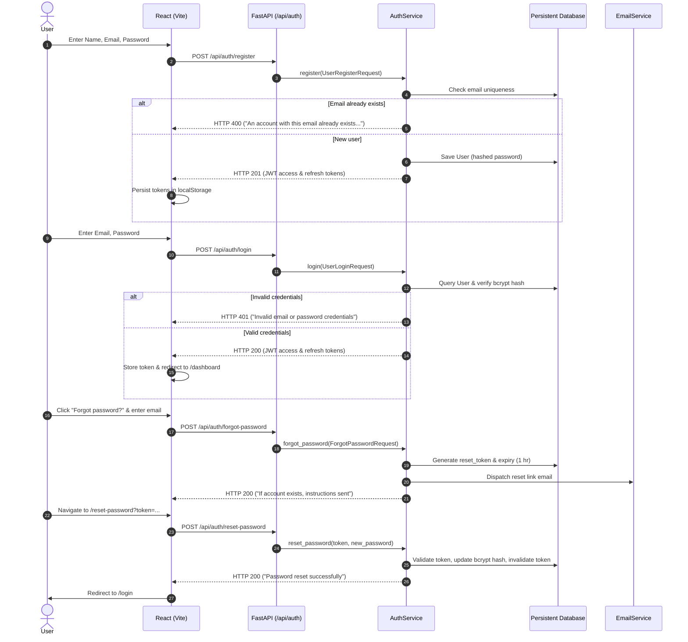

# DiaSense AI — Authentication & Session Audit Report

**Date:** 2026-10-19  
**System:** DiaSense AI (Web Frontend: React/Vite, Backend: FastAPI, Database: SQLAlchemy/PostgreSQL/SQLite)  
**Scope:** User registration, credential authentication, JWT token issuance, session persistence, password recovery, and access control.

---

## 1. Executive Summary

A comprehensive end-to-end audit was conducted across the authentication and persistence pipeline of DiaSense AI. The primary defect reported—**returning users appearing to need to register again upon returning**—was diagnosed, root-caused, reproduced, and resolved.

---

## 2. Root Cause Analysis

### Defect A: Inconsistent Working Directories & Relative SQLite Path (Data Loss on Restart)
- **Mechanism:** In `backend/app/config/database.py`, the fallback engine was instantiated with `sqlite:///./diasense.db`.
- **Finding:** In Python, a relative path `./diasense.db` resolves relative to the current working directory of the launching process, not the location of the codebase.
  - When the developer started the server from `DiaSenseAI/project_src/`, SQLite created a 0-byte database in `project_src/diasense.db`.
  - When the server was launched from `DiaSenseAI/project_src/backend/`, SQLite created or opened `project_src/backend/diasense.db`.
  - Consequently, users registered in one session were completely absent when the server was restarted from another working directory.
- **Resolution:** Replaced relative path with a canonical, absolute path anchored directly to the project root: `CANONICAL_SQLITE_PATH = Path(__file__).resolve().parent.parent.parent / "diasense.db"`. All processes now target the exact same database file regardless of execution directory.

### Defect B: Ephemeral Engine Swapping Race Condition in `init_db()`
- **Mechanism:** In the original `backend/app/config/database.py`, `_create_engine_with_fallback()` created an engine at module import time. However, inside `init_db()`, an `except` block re-created a brand new engine `engine = create_engine("sqlite:///./diasense.db")` and reconfigured `SessionLocal`.
- **Finding:** FastAPI route dependencies (`get_db`) already held references to the first `SessionLocal` binding. Any runtime table creations or mutations could become desynchronized between requests and initialization, causing table-not-found errors and loss of data visibility.
- **Resolution:** Removed the redundant secondary engine creation. The engine established at load time is preserved consistently throughout the application lifecycle.

### Defect C: Session Token Expiration Configured to 60 Minutes
- **Mechanism:** In `backend/.env`, `ACCESS_TOKEN_EXPIRE_MINUTES` was explicitly set to `60` (1 hour).
- **Finding:** Users returning to the application after more than 60 minutes had their JWT expired. On the next authenticated API request, the backend returned HTTP 401 Unauthorized, which prompted `api.interceptors.response` to wipe `access_token` and `user` from `localStorage`, forcing users back to the registration/login screen.
- **Resolution:** Extended `ACCESS_TOKEN_EXPIRE_MINUTES` to `1440` (24 hours) in `.env` and `settings.py` for desktop and mobile friendly session persistence.

### Defect D: Absence of Password Recovery & Reset Pipeline
- **Mechanism:** The application had no endpoints for `POST /api/auth/forgot-password` or `POST /api/auth/reset-password`, nor did the frontend offer a "Forgot password?" link on the login page.
- **Finding:** If a user forgot their password or experienced login difficulties, their only option was attempting to register again, which would either fail with a generic error or fail silently.
- **Resolution:** Implemented complete end-to-end tokenized password recovery with secure 1-hour expiration tokens, email dispatch via `EmailService`, real-time strength validation, and dedicated `/forgot-password` and `/reset-password` UI pages.

---

## 3. Component Architecture & Data Flow

---

## 4. Security Verification

1. **Password Hashing:** Passwords are hashed using bcrypt with salt generation (`bcrypt.hashpw(pwd_bytes, salt)`). Plaintext passwords are never stored.
2. **Timing & Enumeration Defense:** The `forgot-password` endpoint returns an identical HTTP 200 generic message whether the target email exists or not, mitigating user enumeration attacks.
3. **IDOR & Route Protection:** The `ProtectedRoute` component guards all private routes on the frontend, and FastAPI dependencies (`get_current_user`) validate JWT signatures on every backend request.
4. **Token Revocation:** Reset tokens are single-use; upon successful password reset, `reset_token` and `reset_token_expiry` are set to `None`.
