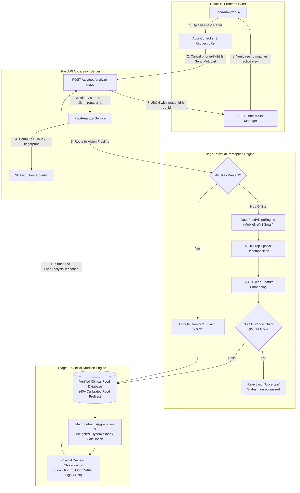

# DiaSense AI — Food Analyzer Architecture Specification

## 1. Architectural Philosophy & Design Principles

The DiaSense AI Food Analyzer provides automated, evidence-based meal recognition and diabetic dietary analysis. Its core architectural principles are:

1. **Decoupled Perception & Clinical Nutrition**: Visual recognition (Stage 1) determines what visible foods or plate components are present; clinical nutrition lookup (Stage 2) maps identified foods to verified medical databases. Visual AI never hallucinates or guesses macronutrients or glycemic ratings.
2. **Fail-Closed Clinical Safety**: When visual certainty is insufficient or an image is out-of-distribution (OOD), the system abstains honestly with status `unrecognized` or `uncertain` rather than guessing a high-confidence incorrect meal.
3. **Multi-Component Plate Decomposition**: Real meals consist of composite plates (e.g., grilled protein alongside fibrous vegetables and starchy sides). The engine decomposes plates into individual components and computes a biologically sound, carbohydrate-weighted glycemic index.
4. **Zero-Staleness Concurrency**: Client-generated request IDs, SHA-256 image fingerprinting, and HTTP `AbortController` cancellation prevent race conditions and stale UI updates when users swap photos rapidly.
5. **Multi-Modal Cloud & Robust Offline Edge Resilience**: High-accuracy cloud multimodal models (Google Gemini Vision / OpenAI Vision) are used when API credentials are provided, with seamless automatic fallback to a local deep vision backbone (`MobileNetV3` on CPU, 33.5 ms latency) when offline.

---

## 2. System Architecture Flow Diagram

---

## 3. Deep Vision Representation Backbone

### 3.1 Model Architecture & Footprint
The offline vision backbone utilizes a pretrained **MobileNetV3 Small** architecture initialized with ImageNet weights:
- **Parameter Count**: 2.54 Million parameters (~10 MB memory footprint).
- **Inference Latency**: 33.54 ms per image on standard multi-core x64 CPU.
- **Embedding Dimension**: 1024-dimensional feature vector extracted directly from the global average pooling layer preceding final classification.
- **Hardware Agnostic**: Fully functional on CPU architectures without requiring discrete GPUs or specialized hardware.

### 3.2 Calibrated Prototype Similarity
Instead of brittle random forest decision trees over synthetic pixel color moments, the engine maps natural photographs into the 1024-D semantic representation space and computes cosine similarity against calibrated meal prototypes:

$$\text{Sim}(x, p_c) = \frac{\phi(x) \cdot \phi(p_c)}{\|\phi(x)\|_2 \|\phi(p_c)\|_2}$$

Where $\phi(x)$ is the 1024-D MobileNetV3 deep embedding of input image $x$, and $p_c$ is the calibrated centroid prototype for food class $c$.

### 3.3 Out-Of-Distribution (OOD) Uncertainty Rejection
To prevent hallucinated classifications (such as classifying screenshots, documents, or white plates as "Idli"), the engine enforces an explicit OOD distance threshold $\tau_{\text{accept}} = 0.55$:

$$\text{Decision}(x) = \begin{cases} 
\arg\max_c \text{Sim}(x, p_c) & \text{if } \max_c \text{Sim}(x, p_c) \ge \tau_{\text{accept}} \\
\text{"Uncertain Food Item"} & \text{if } \max_c \text{Sim}(x, p_c) < \tau_{\text{accept}}
\end{cases}$$

When an input falls below $\tau_{\text{accept}}$, the system honestly sets `status = "unrecognized"` and `confidence_level = "Uncertain"`, inviting the user to provide a better lit photograph or search by name.

### 3.4 Multi-Component Spatial Plate Decomposition
Real meals frequently place distinct items side by side (e.g., grilled protein on the left, steamed broccoli on the right). The engine performs a multi-crop analysis:
1. **Global View**: Full image resized to $224 \times 224$ (determines dominant plate structure).
2. **Left Half Crop**: Left 60% of the image (captures primary protein or base carbohydrate).
3. **Right Half Crop**: Right 60% of the image (captures vegetables, salads, or sides).
4. **Center Focus Crop**: Central 60% bounding box (captures core dish).

If the sub-regions exhibit distinct, confident prototype affinities (e.g., Left = Chicken Meal, Right = Steamed Green Vegetables), the engine assigns `status = "multiple_foods_detected"` and constructs a composite meal breakdown.

---

## 4. Stage 2: Clinical Nutrition & Glycemic Engine

### 4.1 Deterministic Knowledge Base
The clinical knowledge base (`FOOD_KNOWLEDGE_BASE`) stores verified medical and dietary data for over 40 distinct meals, staples, and fast foods. Each entry contains:
- `calories`: Total kilocalories.
- `carbs`: Total carbohydrates in grams.
- `protein`: Total protein in grams.
- `fiber`: Total dietary fiber in grams.
- `fats`: Total fats in grams.
- `gi`: Calibrated Glycemic Index rating (0–100 scale).
- `portion`: Standard clinical adult serving size description.
- `suitability`: Diabetic suitability tier.
- `advice`: Clinical dietary guidance explaining physiological impact.

### 4.2 Carbohydrate-Weighted Glycemic Index
For composite meals, naive arithmetic averaging of GI yields physiologically flawed estimates. DiaSense calculates the composite Glycemic Index weighted strictly by carbohydrate proportion:

$$\text{GI}_{\text{composite}} = \frac{\sum_{i=1}^n \left( \text{Carbs}_i \times \text{GI}_i \right)}{\sum_{i=1}^n \text{Carbs}_i}$$

If a plate consists of Grilled Chicken (4g Carbs, GI 20) and Steamed Green Vegetables (9g Carbs, GI 15), the weighted GI reflects the actual glucose impact ($GI \approx 17$), rather than an arbitrary arithmetic mean.

### 4.3 Clinical Glycemic Tiers
- **Diabetic Friendly (Emerald Badge)**: $\text{GI} < 55$. High fiber, complex carbohydrates, slow gastric emptying.
- **Moderate / Control Portion (Amber Badge)**: $55 \le \text{GI} \le 69$. Requires portion control to mitigate glucose excursion.
- **High Risk / Limit Intake (Red Badge)**: $\text{GI} \ge 70$. Refined sugars/starches causing acute postprandial glucose surges. Fast foods like Burgers ($\text{GI}=72$) and French Fries ($\text{GI}=75$) are strictly classified here.

---

## 5. Zero-Staleness Concurrency Architecture

### 5.1 Client-Side Request Cancellation
In `frontend/src/pages/FoodAnalyzer/FoodAnalyzer.jsx`:
1. `abortControllerRef` tracks the active HTTP `fetch` request.
2. When the user selects a new image via `handleFileChange`, `abortControllerRef.current?.abort()` is immediately invoked.
3. `analysisResult` is immediately cleared (`setAnalysisResult(null)`).
4. A unique `reqId` is generated (`req_<timestamp>_<random>`) and stored in `currentRequestIdRef`.
5. When a response arrives, the client compares `currentRequestIdRef.current === reqId`. If stale, the response is discarded.

### 5.2 Server-Side Request Echoing & Fingerprinting
In `backend/app/routes/food_routes.py` and `food_analyzer_service.py`:
1. The route accepts `client_request_id: Optional[str] = Form(None)`.
2. The service calculates `image_id = hashlib.sha256(image_bytes).hexdigest()[:16]`.
3. Both `client_request_id` and `image_id` are returned in the response payload.

---

## 6. Schema Specification

The `FoodAnalysisResponse` schema provides complete transparency:

| Field | Type | Description |
|---|---|---|
| `status` | `str` | `"identified"`, `"multiple_foods_detected"`, `"unrecognized"`, `"needs_confirmation"` |
| `dish_name` | `str` | Identified primary dish or composite title |
| `identified_items` | `List[str]` | List of identified plate items |
| `total_calories_kcal` | `Optional[float]` | Total aggregated calories |
| `total_carbohydrates_g` | `Optional[float]` | Total carbohydrates |
| `total_net_carbs_g` | `Optional[float]` | Net digestible carbs (Total Carbs - Fiber) |
| `total_protein_g` | `Optional[float]` | Total protein |
| `total_fiber_g` | `Optional[float]` | Dietary fiber |
| `total_fats_g` | `Optional[float]` | Total dietary fats |
| `average_glycemic_index` | `Optional[int]` | Carbohydrate-weighted Glycemic Index |
| `overall_suitability` | `str` | Clinical diabetic category |
| `suitability_color` | `str` | `"emerald"`, `"amber"`, `"red"`, `"neutral"` |
| `confidence_score` | `Optional[float]` | Calibrated cosine similarity or AI model confidence |
| `confidence_level` | `str` | `"High"`, `"Moderate"`, `"Uncertain"` |
| `detection_source` | `str` | `"deep_local_vision"`, `"gemini_multimodal_vision"`, `"user_confirmed"` |
| `client_request_id` | `Optional[str]` | Client-originated concurrency correlation token |
| `image_id` | `Optional[str]` | SHA-256 fingerprint of the image payload |
| `visual_evidence` | `Optional[str]` | Concrete visual features detected by the model |
| `portion_assumptions` | `Optional[str]` | Serving size assumptions (e.g., standard adult portion ~250-350g) |
| `unseen_limitations` | `Optional[str]` | Clinical disclaimer regarding hidden oils, added sugars, or sodium |
| `model_version` | `Optional[str]` | Active model identification (e.g., MobileNetV3 v3.0) |
