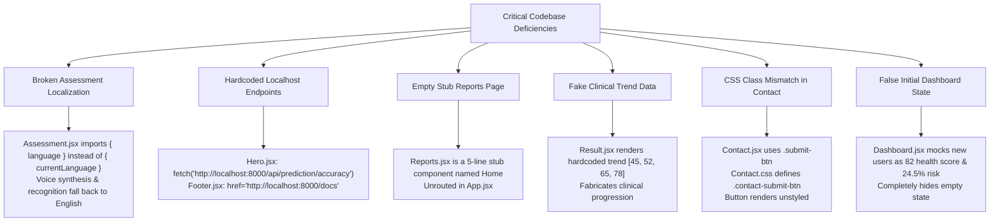
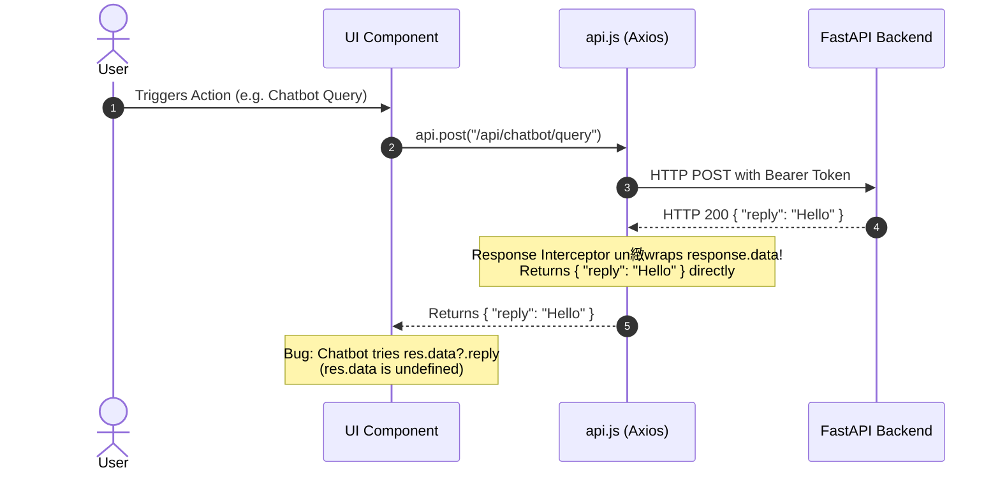
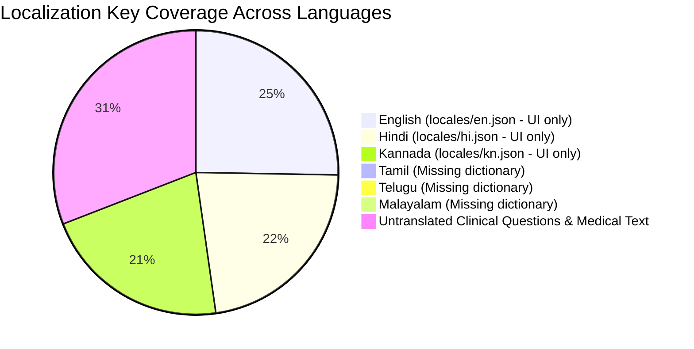

# DiaSense AI — Comprehensive Frontend Codebase Audit

**Audit Date:** October 17, 2026  
**Auditor:** Senior Software Engineer / Code Reviewer  
**Scope:** Complete frontend source audit covering all 57 files in exact architectural sequence  
**Target Environment:** React 19.2.7 / Vite 8.1.1 / React Router DOM 7.18.1 / Tailwind CSS 4.3.3 / Axios 1.18.1  

---

## Table of Contents
1. [File-by-File Audit (Files 1 – 57)](#file-by-file-audit)
   - [Core Application Setup (Files 1–4)](#core-application-setup)
   - [Services & State Infrastructure (Files 5–7)](#services--state-infrastructure)
   - [Shared & Layout Components (Files 8–23)](#shared--layout-components)
   - [Authentication Pages (Files 24–28)](#authentication-pages)
   - [Dashboard & Assessment (Files 29–33)](#dashboard--assessment)
   - [Clinical Results & Dietary Guidance (Files 34–37)](#clinical-results--dietary-guidance)
   - [Ancillary Healthcare Pages (Files 38–48)](#ancillary-healthcare-pages)
   - [Utilities & Localization Dictionaries (Files 49–52)](#utilities--localization-dictionaries)
   - [Configuration & Environment (Files 53–57)](#configuration--environment)
2. [Comprehensive End Summary (11 Distinct Sections)](#comprehensive-end-summary)
   - [1. Critical Issues](#1-critical-issues)
   - [2. Routing & Navigation Architecture](#2-routing--navigation-architecture)
   - [3. API Integration & Network Layer](#3-api-integration--network-layer)
   - [4. State Management Architecture](#4-state-management-architecture)
   - [5. UI/UX, Responsive Design & Accessibility](#5-uiux-responsive-design--accessibility)
   - [6. Deep Dive: Food Analyzer Page](#6-deep-dive-food-analyzer-page)
   - [7. Deep Dive: Assessment Page](#7-deep-dive-assessment-page)
   - [8. Deep Dive: Dashboard Page](#8-deep-dive-dashboard-page)
   - [9. Deep Dive: Reports Page](#9-deep-dive-reports-page)
   - [10. Localization & Internationalization Status](#10-localization--internationalization-status)
   - [11. Missing & Referenced Features](#11-missing--referenced-features)

---

# File-by-File Audit

---

## Core Application Setup

### 1. `frontend/src/App.jsx`
- **Purpose / Functionality:** Serves as the top-level application shell and routing controller. Establishes the `BrowserRouter`, wraps routes in layout chrome (`Navbar`, `Chatbot`, `ToastContainer`), and defines route mappings for public and protected paths.
- **Key Issues:**
  - **Missing `/reports` Route:** `Reports.jsx` exists in the filesystem (`pages/Reports/Reports.jsx`), but is never imported or assigned a route path in `App.jsx`.
  - **No 404 / Catch-all Wildcard Route:** Lacks `<Route path="*" element={<NotFound />} />`. Invalid URLs render an empty layout shell instead of a friendly 404 page or redirect to `/`.
  - **Decoupled Chatbot Rendering:** The global `Chatbot` is rendered on all pages, but internally hides itself if `localStorage.getItem("access_token")` is missing.
- **Missing Error Handling:** Lacks a top-level React `ErrorBoundary`. An uncaught runtime exception in any page component crashes the entire React application into a blank screen.
- **Hardcoded Values:** All route paths (`"/login"`, `"/register"`, `"/assessment"`, `"/dashboard"`, etc.) are hardcoded string literals rather than centralized route constants.
- **State Management Issues:** Does not maintain top-level authentication state. Route protection cannot react to external auth changes (like token expiry or clearing in another tab).

---

### 2. `frontend/src/main.jsx`
- **Purpose / Functionality:** Client entry point. Mounts the root React DOM node into `#root`, wraps the tree in `LanguageProvider`, and mounts the global `ToastContainer`.
- **Key Issues:**
  - **Omission of `React.StrictMode`:** Does not wrap `<App />` in `<React.StrictMode>`, hiding potential side-effect issues, unsafe lifecycles, and deprecated API warnings in development.
  - **Inflexible Toast Theme:** `ToastContainer` is hardcoded to `theme="dark"`.
- **Missing Error Handling:** No global error boundary or `window.addEventListener('unhandledrejection')` handler at application initialization.
- **Hardcoded Values:** `position="top-right"`, `autoClose={3000}`, `theme="dark"`.
- **State Management Issues:** Only initializes `LanguageProvider`. Lacks an `AuthProvider`, forcing all descendant components to independently query and manipulate `localStorage`.

---

### 3. `frontend/src/index.css`
- **Purpose / Functionality:** Defines global CSS variables (`--primary`, `--primary-dark`, `--accent`, `--bg-dark`, etc.), imports Tailwind CSS via `@import "tailwindcss";`, imports Google Fonts (Inter, Plus Jakarta Sans, Noto Sans Indic scripts), and provides script-specific font classes (`.font-kannada`, `.font-hindi`, etc.).
- **Key Issues:**
  - **Tailwind v4 / Custom CSS Coexistence:** Mixes Tailwind v4 engine directives with heavy custom CSS variable rules, resulting in competing class namespaces and redundant utility overrides.
  - **Unapplied Font Classes:** Script font classes (`.font-kannada`, `.font-hindi`) are defined but never systematically attached to DOM nodes when language changes.
- **Missing Error Handling:** N/A (CSS).
- **Hardcoded Values:** Hardcoded color values (`#0f766e`, `#14b8a6`, `#0f172a`, `#111827`, `#f0fdfa`) and static Google Font URL imports.
- **State Management Issues:** Language font switching is disconnected from `LanguageContext`.

---

### 4. `frontend/src/App.css`
- **Purpose / Functionality:** Legacy stylesheet containing wrapper layout definitions (`.app-wrapper`, `.content-wrapper`, `.main-content`), reset styles, and legacy utility classes.
- **Key Issues:**
  - **Dead Code & Class Collisions:** Contains legacy rules like `.hero`, `.hero-title`, and `.btn` that conflict with scoped component stylesheets (`Hero.css`, `Navbar.css`).
  - **Redundant Global Rules:** Duplicates typography, transitions, and container rules already established in `index.css`.
- **Missing Error Handling:** N/A (CSS).
- **Hardcoded Values:** Fixed container widths (`max-width: 1200px`), min-height calculations (`min-height: 80vh`), and fixed z-index indices.
- **State Management Issues:** N/A.

---

## Services & State Infrastructure

### 5. `frontend/src/services/api.js`
- **Purpose / Functionality:** Centralized Axios instance configuration (`baseURL`, interceptors) and API service abstractions (`authService`, `predictionService`, `dietService`, `contactService`, `reportService`, `chatbotService`, `foodService`, `nearbyCareService`, `smartAssessmentService`).
- **Key Issues:**
  - **Payload Unwrapping Discrepancy:** The response interceptor returns `response.data`. However, several consuming components (e.g., `Chatbot.jsx`) still expect an Axios response wrapper and attempt to access `res.data.reply`, causing bugs.
  - **Silent 401 Expiry Without Redirection:** On 401 Unauthorized, the response interceptor removes `access_token` and `user` from `localStorage`, but does NOT redirect the user to `/login` or emit an event. The user remains on the protected page in a frozen, broken state.
  - **Arbitrary `id === 1` Branching in `reportService`:**
    In both `getPdfUrl` and `downloadPdf`, the service contains hardcoded special-casing:
    ```javascript
    const path = (id && id !== 1) ? `/api/reports/${id}/pdf` : `/api/reports/latest/pdf`;
    ```
    If `id === 1`, it forces `/api/reports/latest/pdf` rather than querying report #1!
  - **Direct Axios Invocations Bypass Client:** `downloadLatestPdf` and `downloadPdf` bypass the configured `api` instance and invoke `axios.get(...)` directly with manual header assembly, losing centralized error handling and request interception.
- **Missing Error Handling:** Network errors without an HTTP response (`error.response` is undefined) are rejected as raw objects without user-friendly messaging.
- **Hardcoded Values:**
  - Fallback baseURL: `import.meta.env.VITE_API_BASE_URL || ""`.
  - Hardcoded PDF download filenames: `"DiaSense_Health_Report.pdf"` and `"DiaSense_Health_Report_${id}.pdf"`.
- **State Management Issues:** Direct coupling to `localStorage` without reactive listeners.

---

### 6. `frontend/src/context/LanguageContext.jsx`
- **Purpose / Functionality:** React Context providing internationalization state (`currentLanguage`), dynamic switching (`changeLanguage`), and string lookup helper `t(key)`.
- **Key Issues:**
  - **CRITICAL EXPORT MISMATCH:** The context exports `{ currentLanguage, changeLanguage, t, supportedLanguages }`. However, `Assessment.jsx` expects `{ t, language } = useTranslation();`. Because `language` is undefined, voice synthesis and recognition fail or fall back to English!
  - **Phantom Supported Languages:** Exposes Tamil (`ta`), Telugu (`te`), and Malayalam (`ml`) in `supportedLanguages`, but locale JSON files only exist for `en`, `hi`, and `kn`. Choosing `ta`, `te`, or `ml` causes fallbacks to raw untranslated keys.
- **Missing Error Handling:** Missing translation keys return the raw key string without logging developer warnings in development mode.
- **Hardcoded Values:** Default language `'en'`; localStorage key `'diasense_language'`.
- **State Management Issues:** Does not set `lang` or `dir` attributes on `<html lang="...">` in the DOM document root when the language changes.

---

### 7. `frontend/src/hooks/useVoiceAssistant.js`
- **Purpose / Functionality:** Custom React hook providing browser Web Speech API integration: Speech-to-Text (`webkitSpeechRecognition` / `SpeechRecognition`) and Text-to-Speech (`window.speechSynthesis`).
- **Key Issues:**
  - **Missing `voiceschanged` Listener:** Queries `window.speechSynthesis.getVoices()` synchronously during mount. In Chromium browsers, voices load asynchronously; calling `getVoices()` on load returns an empty array, causing voice synthesis to fail to select an Indic voice.
  - **Browser Compatibility Fragility:** Relies on vendor-prefixed `webkitSpeechRecognition`. On non-Chromium browsers (Firefox), it returns `isSupported = false` without offering a graceful UI fallback or warning.
- **Missing Error Handling:** `recognition.onerror` captures error codes but fails to provide distinct user-facing messages for `not-allowed`, `no-speech`, or `network`.
- **Hardcoded Values:** Hardcoded voice rate (`0.95`), pitch (`1.0`), and language mappings (`'en-IN'`, `'hi-IN'`, `'kn-IN'`).
- **State Management Issues:** `isListening` and `isSpeaking` states can become desynchronized if synthesis is cancelled externally or if recognition is aborted unexpectedly.

---

## Shared & Layout Components

### 8. `frontend/src/components/Navbar/Navbar.jsx`
- **Purpose / Functionality:** Responsive top navigation header containing the DiaSense AI brand, navigation links, LanguageSelector dropdown, authentication status actions (Login/Register vs Dashboard/Profile/Logout), and mobile menu toggle.
- **Key Issues:**
  - **No Link to Reports:** There is no navigation link or menu item for `/reports`.
  - **Decentralized Auth Detection:** Evaluates `localStorage.getItem("access_token")` on route change (`useLocation`). It does not subscribe to any auth context; clearing tokens elsewhere does not update the navbar until navigation occurs.
- **Missing Error Handling:** `handleLogout` does not wrap `authService.logout()` in a `try/finally` block; an API error during logout could abort local token removal.
- **Hardcoded Values:** Brand label `"DiaSense AI"`, route strings.
- **State Management Issues:** Duplicates authentication state inside local component state (`isLoggedIn`).

---

### 9. `frontend/src/components/Navbar/Navbar.css`
- **Purpose / Functionality:** Styles navigation bar layout, desktop links, mobile hamburger drawer, active link indicators, and Indic script font sizes.
- **Key Issues:**
  - **Mobile Menu Z-Index Conflict:** Fixed z-index (`z-index: 1000`) clashes with modal dialogs and dropdown menus.
  - **Overflow on Narrow Devices:** On screens below 360px, brand title and language picker collide.
- **Missing Error Handling:** N/A (CSS).
- **Hardcoded Values:** Fixed height `70px`, color hexes (`#0f766e`, `#111827`, `#e5e7eb`).
- **State Management Issues:** N/A.

---

### 10. `frontend/src/components/ProtectedRoute/ProtectedRoute.jsx`
- **Purpose / Functionality:** Route guard wrapper ensuring only authenticated users access protected routes (`/dashboard`, `/assessment`, `/result`, `/diet-plan`, `/food-analyzer`, `/profile`).
- **Key Issues:**
  - **Destination Route Discarded:** Redirects unauthenticated users to `/login` without passing `state={{ from: location }}`. Users cannot be returned to their intended page after logging in.
  - **Hardcoded English Notification:** Calls `toast.error("Please login to access this page")` directly in English without using `t()`.
  - **No JWT Validity Check:** Only tests `localStorage.getItem("access_token") !== null`. Expired tokens pass the check until an API call fails.
- **Missing Error Handling:** No decoding or structural check of the JWT token string.
- **Hardcoded Values:** Redirect path `"/login"`, toast message string.
- **State Management Issues:** Evaluates `localStorage` synchronously during render.

---

### 11. `frontend/src/components/Chatbot/Chatbot.jsx`
- **Purpose / Functionality:** Floating medical AI assistant widget offering conversational diabetic health advice, suggested questions, and automated disclaimer notices.
- **Key Issues:**
  - **CRITICAL DATA ACCESS BUG:**
    ```javascript
    const botMessage = res.data?.reply || res.reply || ...
    ```
    Since `api.js` un緻wraps `response.data`, `res` is already the payload. While fallback `res.reply` catches it, the ambiguity indicates improper API contract comprehension.
  - **Hidden for Public Visitors:** Returns `null` if `localStorage.getItem("access_token")` is missing. Unauthenticated prospective users exploring the platform cannot test or interact with the chatbot.
  - **Deprecated Keyboard Event:** Uses `onKeyPress={(e) => e.key === "Enter" && handleSend()}` instead of modern `onKeyDown`.
- **Missing Error Handling:** If `chatbotService.query` fails, appends an error bubble to the chat, but provides no option to retry the failed prompt.
- **Hardcoded Values:** Hardcoded English fallback bot greeting and disclaimer text.
- **State Management Issues:** Chat history is ephemeral React state; navigating between pages or refreshing clears the entire conversation.

---

### 12. `frontend/src/components/Chatbot/Chatbot.css`
- **Purpose / Functionality:** Styles floating launcher badge, chat drawer modal, message bubbles, bot typing loader, and prompt chip pills.
- **Key Issues:**
  - **Z-Index Extremity:** Hardcoded `z-index: 9999` can obscure toast notifications and modal alerts.
  - **Fixed Sizing on Desktop:** Fixed width `380px` and height `520px` does not adapt to short viewports.
- **Missing Error Handling:** N/A (CSS).
- **Hardcoded Values:** `bottom: 24px`, `right: 24px`, `#0f766e`.
- **State Management Issues:** N/A.

---

### 13. `frontend/src/components/RiskGauge/RiskGauge.jsx`
- **Purpose / Functionality:** Visual animated SVG gauge displaying diabetic risk probability percentage, risk tier label, and dynamic color coding (Green/Amber/Red).
- **Key Issues:**
  - **Threshold Inconsistency with Clinical Engine:**
    Switches colors at `< 30%` (green), `30-60%` (amber), and `> 60%` (red). However, `Result.jsx` uses `31.0%` for clinical high-risk alert triggers, and backend models use different calibration boundaries.
  - **Missing Accessibility Attributes:** Missing `role="progressbar"`, `aria-valuenow`, `aria-valuemin`, and `aria-valuemax` on the SVG container.
- **Missing Error Handling:** Falls back to `0%` if value is null/NaN, but fails to indicate missing or invalid score state.
- **Hardcoded Values:** Radius `70`, circumference constants, stroke widths.
- **State Management Issues:** Pure presentational component.

---

### 14. `frontend/src/components/RiskGauge/RiskGauge.css`
- **Purpose / Functionality:** Styles circular gauge wrapper, numerical display, risk level pill badge, and SVG stroke transitions.
- **Key Issues:** Minimal styling; no major defects.
- **Missing Error Handling:** N/A.
- **Hardcoded Values:** Font weights and dimensions.
- **State Management Issues:** N/A.

---

### 15. `frontend/src/components/LanguageSelector/LanguageSelector.jsx`
- **Purpose / Functionality:** Language dropdown switcher supporting 6 Indian languages with native script labels and document click-outside dismissal.
- **Key Issues:**
  - **Deceptive Language Options:** Offers Tamil, Telugu, and Malayalam in the menu, but `locales/` only contains `en.json`, `hi.json`, and `kn.json`. Selecting Tamil, Telugu, or Malayalam silently falls back to English.
- **Missing Error Handling:** Handles outside clicks properly; no missing error handling.
- **Hardcoded Values:** Hardcoded language metadata array (codes, native names, English names).
- **State Management Issues:** Correctly consumes `useTranslation()`.

---

### 16. `frontend/src/components/LanguageSelector/LanguageSelector.css`
- **Purpose / Functionality:** Styles dropdown trigger button, popover menu, language option rows, and active checkmark.
- **Key Issues:**
  - **Viewport Edge Cliping:** Positioned `absolute` with `right: 0`; on mobile viewports under 340px, can clip outside the viewport.
- **Missing Error Handling:** N/A.
- **Hardcoded Values:** `min-width: 160px`, `z-index: 1000`.
- **State Management Issues:** N/A.

---

### 17. `frontend/src/components/Hero/Hero.jsx`
- **Purpose / Functionality:** Main landing page hero banner presenting value proposition, CTA buttons, and real-time platform statistics (Model Accuracy, Total Assessments).
- **Key Issues:**
  - **CRITICAL BUG — HARDCODED LOCALHOST URL:**
    ```javascript
    fetch("http://localhost:8000/api/prediction/accuracy")
    ```
    Hardcoded to `localhost:8000`, completely bypassing Vite dev proxy and `api.js` base URL configuration. In production, this fetch fails immediately.
  - **DEAD CODE — UNUSED SERVICE CALL:**
    Imports `predictionService` and executes:
    ```javascript
    predictionService.getLatest().then().catch()
    ```
    in a `useEffect`, but completely ignores and discards the result.
- **Missing Error Handling:** Fallback values are displayed on fetch failure, but network errors are swallowed without telemetry.
- **Hardcoded Values:** `"http://localhost:8000/api/prediction/accuracy"`, fallback accuracy `"94.2%"`, count `"10,000+"`.
- **State Management Issues:** Local stats state.

---

### 18. `frontend/src/components/Features/Features.jsx`
- **Purpose / Functionality:** 6-card feature showcase highlighting Dual AI Engines, Voice Assistant, Personalized Diets, Explainable AI, Nearby Care, and Smart Lab OCR.
- **Key Issues:**
  - **Non-Interactive Cards:** Cards have hover elevation styling, giving the impression of clickability, but none of them link to their respective pages (`/food-analyzer`, `/find-care`, `/diet-plan`, `/assessment`).
- **Missing Error Handling:** N/A.
- **Hardcoded Values:** Icon component mappings.
- **State Management Issues:** Pure presentational component.

---

### 19. `frontend/src/components/CTA/CTA.jsx`
- **Purpose / Functionality:** Bottom banner on landing page prompting users to start their risk assessment.
- **Key Issues:**
  - **Decentralized Auth Check:** Evaluates `localStorage.getItem("access_token")` on render to decide whether to navigate to `/assessment` or `/register`.
- **Missing Error Handling:** N/A.
- **Hardcoded Values:** Hardcoded route destination strings.
- **State Management Issues:** Unsynchronized auth check.

---

### 20. `frontend/src/components/Footer/Footer.jsx`
- **Purpose / Functionality:** Global application footer containing branding, quick navigation links, clinical disclaimer, and developer/API links.
- **Key Issues:**
  - **CRITICAL BUG — HARDCODED LOCALHOST API LINK:**
    ```jsx
    <a href="http://localhost:8000/docs" target="_blank" rel="noopener noreferrer">API Documentation</a>
    ```
    Hardcoded to port 8000 on localhost; breaks in deployed environments.
  - **Hardcoded English Section Headers:** Column titles "Platform", "Information", and "Quick Links" are hardcoded in English instead of using `t()`.
- **Missing Error Handling:** N/A.
- **Hardcoded Values:** `"http://localhost:8000/docs"`, static copyright notice.
- **State Management Issues:** N/A.

---

### 21. `frontend/src/components/BackButton/BackButton.jsx`
- **Purpose / Functionality:** Reusable navigation button invoking `navigate(-1)`.
- **Key Issues:**
  - **External History Trapping:** If the user opens a page directly in a new browser tab or comes from an external site, `navigate(-1)` navigates out of the application or does nothing.
- **Missing Error Handling:** Does not check `window.history.length > 1` or provide a default fallback path (such as `/dashboard`).
- **Hardcoded Values:** Default text `"Back"`.
- **State Management Issues:** N/A.

---

### 22. `frontend/src/components/AuthShowcase/AuthShowcase.jsx`
- **Purpose / Functionality:** Graphic showcase sidebar on Login and Register pages displaying SVG glucometer, animated ECG heartbeat line, and feature bullets.
- **Key Issues:**
  - **Hardcoded English Bullets:** Clinical capability bullets ("Clinical-grade ML risk scoring", "Multilingual voice-guided assessment", "Personalized lifestyle & diet guidance") are hardcoded in English without translation keys.
- **Missing Error Handling:** N/A (visual SVG).
- **Hardcoded Values:** Hardcoded SVG coordinates and English bullet strings.
- **State Management Issues:** N/A.

---

### 23. `frontend/src/components/HowItWorks/HowItWorks.jsx`
- **Purpose / Functionality:** 4-step workflow visualizer on the landing page explaining the clinical process (Data Input, Dual-Engine Analysis, Risk Scoring, Actionable Guidance).
- **Key Issues:** None. Properly wired to `t()` translation keys and semantic markup.
- **Missing Error Handling:** N/A.
- **Hardcoded Values:** Step numeric indices (1, 2, 3, 4).
- **State Management Issues:** N/A.

---

## Authentication Pages

### 24. `frontend/src/pages/Home/Home.jsx`
- **Purpose / Functionality:** Public landing page aggregating `Hero`, `Features`, `HowItWorks`, and `CTA`.
- **Key Issues:** None. Clean container layout.
- **Missing Error Handling:** N/A.
- **Hardcoded Values:** None.
- **State Management Issues:** None.

---

### 25. `frontend/src/pages/Login/Login.jsx`
- **Purpose / Functionality:** User authentication page providing email/password login, demo credentials autofill, token storage, and redirect to `/dashboard`.
- **Key Issues:**
  - **Artificial 700ms Delay:**
    ```javascript
    setTimeout(() => { navigate("/dashboard"); }, 700);
    ```
    Artificially slows navigation without functional benefit.
  - **Destination Redirection Discarded:** Does not check `location.state?.from` to route user back to their requested page.
  - **User Object State Inconsistency:**
    ```javascript
    localStorage.setItem("user", JSON.stringify(res.user || { email: formData.email }));
    ```
    If backend does not include `user` object in response, writes a partial object lacking `name` or `id`, resulting in broken headers in `Dashboard.jsx`.
- **Missing Error Handling:** Does not distinguish 401 (invalid credentials) from 422 (validation error) or 500 (server offline).
- **Hardcoded Values:** Demo credentials `"demo@diasense.ai"`, `"Demo@1234"`, timeout `700`.
- **State Management Issues:** Directly sets `localStorage` items without an application-wide AuthContext update.

---

### 26. `frontend/src/pages/Login/Login.css`
- **Purpose / Functionality:** Styles split-screen authentication screen, input fields, demo button pill, error messages, and mobile stacking.
- **Key Issues:** Tight coupling with `Register.jsx`, which imports this file directly.
- **Missing Error Handling:** N/A (CSS).
- **Hardcoded Values:** Responsive breakpoint `900px`, color gradients.
- **State Management Issues:** N/A.

---

### 27. `frontend/src/pages/Register/Register.jsx`
- **Purpose / Functionality:** New patient account registration with fields for Full Name, Email, Password, Confirm Password, Age, Gender, and Language.
- **Key Issues:**
  - **Inline Style Overrides for Dark Select:** Uses inline `style={{ backgroundColor: "#1e293b", color: "#f8fafc" }}` on the `<select>` element to bypass stylesheet issues.
  - **No Automatic Post-Registration Login:** Redirects to `/login` after successful registration instead of logging in automatically, forcing users to re-type their credentials.
- **Missing Error Handling:** Password criteria validation is performed client-side, but does not gracefully display field-level validation errors returned by backend Pydantic models (HTTP 422).
- **Hardcoded Values:** Password regex rules, minimum length 8.
- **State Management Issues:** Cross-imports `../Login/Login.css`.

---

### 28. `frontend/src/pages/Register/Register.css`
- **Purpose / Functionality:** Intended stylesheet for the Register page.
- **Key Issues:** **Redundant Stub File:** Only contains `@import "../Login/Login.css";`, which is already imported by `Register.jsx` in JavaScript.
- **Missing Error Handling:** N/A.
- **Hardcoded Values:** None.
- **State Management Issues:** N/A.

---

## Dashboard & Assessment

### 29. `frontend/src/pages/Dashboard/Dashboard.jsx`
- **Purpose / Functionality:** Central user hub presenting clinical health cards (Health Score, Risk Level, Glucose, HbA1c), Quick Action tiles, historical assessment records, and report download triggers.
- **Key Issues:**
  - **CRITICAL BUG — MOCK DATA MASKS EMPTY STATE:**
    When a user has zero assessments, `latestPrediction` falls back to:
    ```javascript
    { health_score: 82, risk_level: "Low Risk", risk_probability: 24.5, fasting_glucose: 95, hba1c: 5.4 }
    ```
    A brand-new patient with NO data sees a fake 82 health score and 24.5% risk rather than an empty state prompting them to take an assessment!
  - **History "View Report" Parameter Bug:**
    Clicking "View Report" executes:
    ```javascript
    navigate("/result", { state: { ...item } })
    ```
    However, `Result.jsx` expects `assessment_id` and specific prediction keys. If `item.id` is not mapped, Result page defaults to fallback `REP-00001`.
  - **Recharts Container Layout Warnings:** `ResponsiveContainer` inside CSS flex cards triggers `-1 width/height` console warnings on load.
- **Missing Error Handling:** `predictionService.getHistory()` failures are logged to console without offering a retry button or alert to the user.
- **Hardcoded Values:** Mock metrics (82 health score, 24.5% risk, 95 glucose, 5.4 HbA1c); trend chart static dates.
- **State Management Issues:** History and profile data are fetched once in `useEffect`; no mechanism to re-fetch when returning from a new assessment.

---

### 30. `frontend/src/pages/Dashboard/Dashboard.css`
- **Purpose / Functionality:** Grid layout, metric cards, quick action tiles, history table, and risk badge styles.
- **Key Issues:**
  - **Table Horizontal Overflow on Mobile:** The assessment history table overflows on screens below 640px without wrapping or card transformation.
- **Missing Error Handling:** N/A.
- **Hardcoded Values:** Color codes, CSS grid minmax bounds (`minmax(240px, 1fr)`).
- **State Management Issues:** N/A.

---

### 31. `frontend/src/pages/Assessment/Assessment.jsx`
- **Purpose / Functionality:** Massive 2,170-line multi-modal assessment wizard supporting Manual step-by-step entry, Smart Lab OCR PDF/image extraction, and Voice-guided question answering.
- **Key Issues:**
  - **CRITICAL BUG — UNDEFINED `language` VARIABLE:**
    ```javascript
    const { t, language } = useTranslation();
    ```
    `LanguageContext` exports `currentLanguage`, NOT `language`! Thus `language` is `undefined`. Voice synthesis and speech recognition language selection fail and always default to `"en"`.
  - **Hardcoded English Clinical Questions:** All 16 assessment questions, tooltips, units, and prompts are hardcoded in English inside component definitions rather than pulled from `t()`.
  - **Dead Code:**
    - `handleManualNext` and `validateManualStep` exist as obsolete step validation routines superseded by inline handlers.
    - Unused `MicBtn` component defined in the file.
  - **OCR Parsing Bound Checks:** Lab report values extracted via OCR (`extractReport`) are injected into form state without verifying if numbers fall within physiological sanity ranges.
- **Missing Error Handling:** When `predictionService.predict(payload)` returns HTTP 422, shows generic "Prediction failed" instead of identifying which clinical input is out of bounds.
- **Hardcoded Values:** Hardcoded clinical boundaries (Glucose: 70–300, BMI: 10–60, Blood Pressure: 60–220, Age: 1–120), hardcoded English prompts.
- **State Management Issues:** Massive monolithic state machine with over 25 individual `useState` hooks.

---

### 32. `frontend/src/pages/Assessment/Assessment.css`
- **Purpose / Functionality:** 1,627 lines of styling for wizard steps, voice visualizer audio waveforms, OCR drop zones, range sliders, and metric pills.
- **Key Issues:**
  - **Bloated Selector Specificity:** Extremely deep selector trees make overrides fragile.
  - **Duplicate Keyframes:** `@keyframes pulseRing` and `@keyframes wave` are declared multiple times with identical parameters.
- **Missing Error Handling:** N/A.
- **Hardcoded Values:** Fixed height calculations, pixel bounds, and absolute coordinates.
- **State Management Issues:** N/A.

---

### 33. `frontend/src/pages/Assessment/VoiceEngine.js`
- **Purpose / Functionality:** Speech parsing and conversation management utility for voice assessments. Parses spoken numbers, affirmations, negations, gender terms, and medical vocabulary across Indian languages.
- **Key Issues:**
  - **CRITICAL BUG — `langCode` IGNORED IN `getVoiceQuestion`:**
    ```javascript
    getVoiceQuestion(stepIndex, langCode)
    ```
    The switch/lookup table inside this function completely ignores `langCode` and unconditionally returns English question strings.
  - **Fragile Spoken Number Parsing:** Indic number words (e.g. Hindi "ek sau bees", Kannada "noora ippathu") rely on incomplete regex maps; unhandled words return `null` and cause voice prompt loops.
- **Missing Error Handling:** Does not provide suggestions when user input fails parsing; returns `null` silently.
- **Hardcoded Values:** Hardcoded English question strings and regex patterns.
- **State Management Issues:** Pure utility file.

---

## Clinical Results & Dietary Guidance

### 34. `frontend/src/pages/Result/Result.jsx`
- **Purpose / Functionality:** Diagnostic results page presenting Clinical Risk Level, Dual-Engine comparison (XGBoost vs LightGBM), SHAP feature importance breakdown, lifestyle recommendations, and PDF report triggers.
- **Key Issues:**
  - **CRITICAL BUG — FAKE `trendData` ARRAY:**
    ```javascript
    const trendData = [
      { date: "3 mos ago", risk: 45 },
      { date: "2 mos ago", risk: 52 },
      { date: "Last mo", risk: 65 },
      { date: "Today", risk: Math.round(risk_probability || 78) }
    ];
    ```
    Regardless of user history, displays a completely fake 4-month rising risk trend curve!
  - **Hardcoded Fallback ID `REP-00001`:** If `location.state` lacks an ID, displays hardcoded report number `REP-00001` instead of fetching the latest prediction record.
  - **Threshold Mismatch:** High-risk alert is triggered at `risk_probability > 31.0%`, conflicting with `RiskGauge.jsx` (60%) and standard clinical risk scales.
- **Missing Error Handling:** Direct navigation to `/result` without `location.state` crashes or displays mock defaults because it does not fetch the latest assessment from the API.
- **Hardcoded Values:** Mock `trendData`, fallback `REP-00001`, risk threshold `31.0`.
- **State Management Issues:** State relies entirely on React Router `location.state`; refreshing the browser page loses all context.

---

### 35. `frontend/src/pages/Result/Result.css`
- **Purpose / Functionality:** Styles result summary banner, dual-engine comparison card, risk factor progress bars, recommendation checklist, and print view.
- **Key Issues:**
  - **Dark Theme Print Issue:** In `@media print`, dark backgrounds are not completely stripped, causing heavy ink usage and low-contrast text when printed to paper or PDF.
- **Missing Error Handling:** N/A.
- **Hardcoded Values:** Fixed widths, box shadows, and color variables.
- **State Management Issues:** N/A.

---

### 36. `frontend/src/pages/DietPlan/DietPlan.jsx`
- **Purpose / Functionality:** Generates personalized diet and lifestyle plans based on risk category and dietary preference (Vegetarian, Non-Vegetarian, Jain, Vegan), featuring meal schedules, hydration tracking, and habit streaks.
- **Key Issues:**
  - **DEAD IMPORT — `dietService` NEVER CALLED:**
    Imports `dietService` from `../../services/api`, but NEVER calls `dietService.getPlan(...)` or any backend endpoint. All diet data is loaded from local static file `../../utils/dietSchedules.js`.
  - **Aggressive Empty State Gating:** If no prior assessment is found in `localStorage`, the user is completely locked out of the diet plan page.
  - **Fragile Storage Key Construction:** Hydration and habits are keyed as `diasense_hydration_${userId}`. If `userId` is missing, keys collide as `diasense_hydration_undefined`.
- **Missing Error Handling:** No API calls made; missing validation for hydration goal bounds.
- **Hardcoded Values:** Target water consumption (8 glasses/day), fallback strings.
- **State Management Issues:** Streak and hydration counters rely on localStorage with manual date checking (`new Date().toDateString()`).

---

### 37. `frontend/src/pages/DietPlan/DietPlan.css`
- **Purpose / Functionality:** Styles diet preference selection tabs, meal schedule cards, nutrient breakdown pills, and hydration tracking widgets.
- **Key Issues:**
  - **Grid Squishing on Tablets:** Meal card columns between 640px and 768px cause nutrient pills to wrap awkwardly and overlap card borders.
- **Missing Error Handling:** N/A.
- **Hardcoded Values:** Color gradients, border radii.
- **State Management Issues:** N/A.

---

## Ancillary Healthcare Pages

### 38. `frontend/src/pages/FoodAnalyzer/FoodAnalyzer.jsx`
- **Purpose / Functionality:** Meal glycemic index and nutritional analyzer supporting natural language meal descriptions ("2 rotis with dal and salad") and food photo image uploads.
- **Key Issues:**
  - **Deprecated Keyboard Event:** Uses `onKeyPress={(e) => e.key === "Enter" && handleAnalyze()}` instead of `onKeyDown`.
  - **Missing Client-Side File Validation:** Accepts image files without verifying file size or MIME type before sending `multipart/form-data`, causing silent failures on large uploads.
  - **Case-Sensitive GI Tagging:** Uses `item.glycemic_index?.toLowerCase() === "low"` without trimming or handling unexpected backend status values.
- **Missing Error Handling:** Displays a generic toast when analysis fails, without actionable guidance when regional Indian dishes are unrecognized.
- **Hardcoded Values:** Suggested food chips ("Masala Dosa", "Brown rice with paneer", "Gulab Jamun (2 pcs)").
- **State Management Issues:** Switching between Text and Image tabs wipes current analysis results from component state.

---

### 39. `frontend/src/pages/FoodAnalyzer/FoodAnalyzer.css`
- **Purpose / Functionality:** Styles input tabs, file dropzone area, macro breakdown cards (Carbs, Protein, Fats, Calories), and diabetic friendliness indicator.
- **Key Issues:**
  - **Macro Progress Bar Overflow:** Progress bar widths assume max 100g carbs; meals exceeding 100g overflow visual bounds.
- **Missing Error Handling:** N/A.
- **Hardcoded Values:** Colors (`#22c55e`, `#eab308`, `#ef4444`).
- **State Management Issues:** N/A.

---

### 40. `frontend/src/pages/FindCare/FindCare.jsx`
- **Purpose / Functionality:** Nearby healthcare provider locator for diabetologists, endocrinologists, and diagnostic labs using GPS geolocation or city/pincode search, rendered on an OpenStreetMap Leaflet iframe and list view.
- **Key Issues:**
  - **Geolocation Rejection Dead-End:** When GPS permission is denied, shows an error message, but fails to autofocus or highlight the manual search input.
  - **Offline / Slow Iframe Failure:** Embeds OpenStreetMap directly in an `<iframe>`. Network latency or offline status results in a broken iframe without user feedback.
  - **Redundant Network Calls on Filter Change:** Switching facility category tabs re-queries the API instead of filtering the loaded facility list in-memory.
- **Missing Error Handling:** Geolocation error messages are hardcoded in English.
- **Hardcoded Values:** Default coordinates (Bengaluru: `12.9716, 77.5946`), category filter names ("All", "Diabetologist", "Hospital", "Diagnostic Lab").
- **State Management Issues:** Facilities list not cached between filter changes.

---

### 41. `frontend/src/pages/FindCare/FindCare.css`
- **Purpose / Functionality:** Search bar, filter chips, split view layout (map iframe + provider list), doctor card layout, and contact action buttons.
- **Key Issues:**
  - **Mobile Map Dominance:** Map iframe has fixed height (`260px` mobile, `400px` desktop); on mobile, the map dominates the screen, pushing doctor cards below the viewport.
- **Missing Error Handling:** N/A.
- **Hardcoded Values:** Fixed iframe heights.
- **State Management Issues:** N/A.

---

### 42. `frontend/src/pages/Profile/Profile.jsx`
- **Purpose / Functionality:** User profile management: viewing account info, updating personal details, changing password, and viewing assessment statistics.
- **Key Issues:**
  - **Hardcoded ID Fallback `#1`:**
    ```javascript
    user.id || "#1"
    ```
    If backend user object does not include `id`, displays `#1` on the UI.
  - **Password Change Payload Mismatch Risk:** Submits `{ old_password, new_password }`; if backend expects `current_password`, request fails.
  - **Auth State Desynchronization:** Updating user profile writes to `localStorage` but does NOT update Navbar avatar or header state.
- **Missing Error Handling:** Does not verify that `new_password` differs from `old_password` before sending to the backend.
- **Hardcoded Values:** Fallback ID `"#1"`, fallback avatar initial `"U"`.
- **State Management Issues:** Tab switching between Profile and Password resets unsubmitted input fields.

---

### 43. `frontend/src/pages/Profile/Profile.css`
- **Purpose / Functionality:** Styles profile header, avatar, tabs, form inputs, and assessment summary stats.
- **Key Issues:** Clean layout; minor hover transition inconsistency.
- **Missing Error Handling:** N/A.
- **Hardcoded Values:** Avatar dimensions (`80px`), border radii.
- **State Management Issues:** N/A.

---

### 44. `frontend/src/pages/Reports/Reports.jsx`
- **Purpose / Functionality:** Intended to be the medical reports management center where users can browse, preview, and download past assessment PDF reports.
- **Key Issues:**
  - **CRITICAL DEFECT — EMPTY 5-LINE STUB COMPONENT:**
    ```jsx
    import React from 'react';
    function Home() {
      return <h1>Report Page</h1>;
    }
    export default Home;
    ```
    The component is named `Home`, renders an unstyled `<h1>Report Page</h1>`, is NEVER imported or routed in `App.jsx`, has no styling, and contains zero report viewing or PDF downloading functionality.
- **Missing Error Handling:** Non-existent.
- **Hardcoded Values:** `"Report Page"`.
- **State Management Issues:** None.

---

### 45. `frontend/src/pages/About/About.jsx`
- **Purpose / Functionality:** Explains DiaSense AI's clinical mission, Dual-Engine ML architecture, training datasets (Pima, NHANES, Indian cohorts), and medical advisory board.
- **Key Issues:**
  - **Untranslated English Content:** The entire page consists of large paragraphs hardcoded in English, completely bypassing `t()`.
- **Missing Error Handling:** N/A (static page).
- **Hardcoded Values:** Dataset names, clinical disclaimers.
- **State Management Issues:** None.

---

### 46. `frontend/src/pages/About/About.css`
- **Purpose / Functionality:** Typography, hero banner, architecture diagram styling, team member cards.
- **Key Issues:** None. Clean stylesheet.
- **Missing Error Handling:** N/A.
- **Hardcoded Values:** Margins and colors.
- **State Management Issues:** N/A.

---

### 47. `frontend/src/pages/Contact/Contact.jsx`
- **Purpose / Functionality:** Contact inquiry page with support form, feedback category selector, and support details.
- **Key Issues:**
  - **CRITICAL CSS CLASSNAME MISMATCH BUG:**
    `Contact.jsx` declares:
    ```jsx
    <button type="submit" className="submit-btn" disabled={loading}>
    ```
    However, `Contact.css` defines:
    ```css
    .contact-submit-btn { ... }
    ```
    As a result, the submit button is completely unstyled by `Contact.css` and renders as an unstyled generic browser button.
- **Missing Error Handling:** Catch block shows a generic toast without checking backend error messages.
- **Hardcoded Values:** Support email `"support@diasense.ai"`, phone numbers, office address.
- **State Management Issues:** Form state not reset on unmount.

---

### 48. `frontend/src/pages/Contact/Contact.css`
- **Purpose / Functionality:** Styles contact card, input fields, support details box, and submit button.
- **Key Issues:** Contains `.contact-submit-btn` which is completely dead due to the class name mismatch in `Contact.jsx`.
- **Missing Error Handling:** N/A.
- **Hardcoded Values:** Color variables.
- **State Management Issues:** N/A.

---

## Utilities & Localization Dictionaries

### 49. `frontend/src/utils/dietSchedules.js`
- **Purpose / Functionality:** Static dietary recommendation repository providing daily meal schedules and macro targets for Vegetarian, Non-Vegetarian, Jain, and Vegan diets.
- **Key Issues:**
  - **`isHighRisk` Parameter Completely Ignored:**
    ```javascript
    export const getDietSchedule = (preference = "vegetarian", isHighRisk = false) => {
      // ...
      return DIET_DATA[key] || DIET_DATA.vegetarian;
    };
    ```
    The `isHighRisk` parameter is accepted but never evaluated! Low-risk and moderate-risk users receive the exact same strict dietary restrictions as high-risk diabetic patients.
  - **Static Monotonous Schedule:** All days of the week share the identical meal menu; no daily rotation or variety.
- **Missing Error Handling:** Fallback to vegetarian is present.
- **Hardcoded Values:** Calorie, carb, protein, and fat values.
- **State Management Issues:** Pure data file.

---

### 50. `frontend/src/locales/en.json`
- **Purpose / Functionality:** English localization dictionary containing keys for navigation, authentication, home, dashboard, result, food analyzer, and diet plan.
- **Key Issues:**
  - **Incomplete Key Coverage:** Missing keys for all 16 clinical assessment questions and choices, Voice Engine spoken prompts, About page long-form copy, and Contact page labels.
- **Missing Error Handling:** N/A.
- **Hardcoded Values:** Key-value string pairs.
- **State Management Issues:** N/A.

---

### 51. `frontend/src/locales/hi.json`
- **Purpose / Functionality:** Hindi translation dictionary mirroring `en.json`.
- **Key Issues:**
  - **Missing Clinical Keys:** Assessment questions, options, and voice engine responses are missing.
  - **Transliteration Issues:** Several medical terms use phonetically transliterated English rather than standard Hindi medical terminology.
- **Missing Error Handling:** N/A.
- **Hardcoded Values:** Devanagari strings.
- **State Management Issues:** N/A.

---

### 52. `frontend/src/locales/kn.json`
- **Purpose / Functionality:** Kannada translation dictionary mirroring `en.json`.
- **Key Issues:**
  - **Missing Clinical Keys:** Assessment questions, voice prompts, and about page are missing.
  - **Lengthy Strings Causing Overflow:** Certain button phrases in Kannada are unusually long and cause overflow on small screens when flex-wrap is disabled.
- **Missing Error Handling:** N/A.
- **Hardcoded Values:** Kannada script strings.
- **State Management Issues:** N/A.

---

## Configuration & Environment

### 53. `frontend/package.json`
- **Purpose / Functionality:** Project manifest declaring dependencies, build scripts, and engine specifications.
- **Key Issues:**
  - **Modern Stack:** React 19.2.7, Vite 8.1.1, React Router DOM 7.18.1, Tailwind CSS 4.3.3, Axios 1.18.1, Recharts 3.10.1, Framer Motion 12.42.2.
  - **Missing Test Framework:** Zero testing dependencies installed (no Vitest, Jest, React Testing Library, or Cypress/Playwright).
  - **No Standard i18n Library:** Relies on a custom context instead of established libraries like `i18next` / `react-i18next`, lacking pluralization, interpolation, and namespace splitting.
- **Missing Error Handling:** N/A.
- **Hardcoded Values:** Package name `"frontend"`, version `"0.0.0"`.
- **State Management Issues:** No centralized state management library (Zustand, Redux Toolkit); state is fragmented across `localStorage` and component states.

---

### 54. `frontend/vite.config.js`
- **Purpose / Functionality:** Vite bundler configuration including `@vitejs/plugin-react`, `@tailwindcss/vite`, and dev server proxy settings.
- **Key Issues:**
  - **Dev Proxy Bypassed:** Configures proxy for `/api` targeting `http://127.0.0.1:8000`. However, `Hero.jsx` bypasses this by fetching `http://localhost:8000/api/prediction/accuracy` directly, and `.env.example` sets `VITE_API_BASE_URL=http://localhost:8000`, causing Axios to bypass the Vite proxy.
- **Missing Error Handling:** N/A.
- **Hardcoded Values:** Port `5173`, proxy target `'http://127.0.0.1:8000'`.
- **State Management Issues:** N/A.

---

### 55. `frontend/vercel.json`
- **Purpose / Functionality:** Vercel deployment configuration declaring build commands, output directory (`dist`), SPA rewrite rules (`/(.*)` -> `/index.html`), and asset caching headers.
- **Key Issues:**
  - **Missing Backend API Proxy / Rewrite:** Does not configure API proxy rewrites. If `VITE_API_BASE_URL` is empty in production, relative `/api/*` calls will be rewritten to `/index.html` by the SPA rewrite rule, returning HTML instead of JSON and breaking all API requests.
- **Missing Error Handling:** N/A.
- **Hardcoded Values:** Cache-Control header `max-age=31536000, immutable`.
- **State Management Issues:** N/A.

---

### 56. `frontend/.env.example`
- **Purpose / Functionality:** Environment variable template for developer onboarding.
- **Key Issues:**
  - Declares `VITE_API_BASE_URL=http://localhost:8000`.
  - Lacks documentation for optional environment variables (e.g. Sentry, Analytics, speech service configurations).
- **Missing Error Handling:** N/A.
- **Hardcoded Values:** `"http://localhost:8000"`.
- **State Management Issues:** N/A.

---

### 57. `frontend/.env.production`
- **Purpose / Functionality:** Production environment variable configuration used during Vercel deployment builds.
- **Key Issues:**
  - Points to `https://diasense-ai-backend.onrender.com`. Free-tier Render instances undergo cold-start sleep; frontend requests can stall for 50+ seconds without user feedback or timeout recovery.
- **Missing Error Handling:** N/A.
- **Hardcoded Values:** `https://diasense-ai-backend.onrender.com`.
- **State Management Issues:** N/A.

---

# Comprehensive End Summary

---

## 1. Critical Issues



1. **Broken Assessment Localization (`Assessment.jsx`):**
   `Assessment.jsx` executes `const { t, language } = useTranslation();`. Because `LanguageContext.jsx` exports `currentLanguage`, `language` is `undefined`. Consequently, speech synthesis and voice recognition language selection fall back to `"en"`, breaking voice assessment in Hindi and Kannada.
2. **Hardcoded Localhost Endpoints in Production Code:**
   - `Hero.jsx`: `fetch("http://localhost:8000/api/prediction/accuracy")` directly bypasses environment variables and Vite proxies.
   - `Footer.jsx`: `<a href="http://localhost:8000/docs">` points to localhost port 8000.
3. **Empty Stub Reports Page (`Reports.jsx`):**
   `pages/Reports/Reports.jsx` is an unrouted, 5-line stub named `Home` that returns `<h1>Report Page</h1>`. The dedicated reports center is completely missing.
4. **Fabricated Clinical Trend Data (`Result.jsx`):**
   `Result.jsx` renders a hardcoded static `trendData` array `[45, 52, 65, 78]` representing 3 months of worsening diabetes risk, regardless of whether the user is taking their first assessment or is completely healthy.
5. **CSS Class Mismatch Breaking UI (`Contact.jsx` / `Contact.css`):**
   `Contact.jsx` uses `className="submit-btn"` while `Contact.css` defines `.contact-submit-btn`. The form submit button renders completely unstyled.
6. **False Initial State Masking Zero Data (`Dashboard.jsx`):**
   When a new user with zero assessments views the Dashboard, `Dashboard.jsx` falls back to `{ health_score: 82, risk_level: "Low Risk", risk_probability: 24.5, fasting_glucose: 95, hba1c: 5.4 }`. New users see fake clinical numbers rather than an empty state.
7. **`api.js` Interceptor Silent 401 Expiry:**
   On 401 Unauthorized, `api.js` clears `localStorage` tokens but does not redirect to `/login` or emit an auth event, leaving the user on a frozen, broken screen.

---

## 2. Routing & Navigation Architecture

| Route Path | Component | Protected | Status / Issues Identified |
| :--- | :--- | :---: | :--- |
| `/` | `Home` | No | Operational; contains hardcoded localhost stats fetch in `Hero`. |
| `/login` | `Login` | No | Operational; artificial 700ms delay, discards `from` redirect. |
| `/register` | `Register` | No | Operational; inline select styles, doesn't auto-login. |
| `/assessment` | `Assessment` | Yes | Operational; undefined `language` bug, hardcoded English questions. |
| `/result` | `Result` | Yes | Operational; hardcoded fake trend data, fallback `REP-00001`. |
| `/dashboard` | `Dashboard` | Yes | Operational; fake default health metrics for new users. |
| `/diet-plan` | `DietPlan` | Yes | Operational; uncalled `dietService`, hardcoded client schedules. |
| `/food-analyzer` | `FoodAnalyzer` | Yes | Operational; deprecated `onKeyPress`, missing file size check. |
| `/find-care` | `FindCare` | Yes | Operational; iframe height issues, refetches on filter change. |
| `/profile` | `Profile` | Yes | Operational; fallback ID `#1`, state desynchronization. |
| `/about` | `About` | No | Operational; untranslated English text. |
| `/contact` | `Contact` | No | Operational; unstyled submit button due to CSS class mismatch. |
| `/reports` | `Reports` | **N/A** | **CRITICAL: Not registered in `App.jsx`, file is a 5-line stub.** |
| `*` (Catch-all) | None | **N/A** | **CRITICAL: Missing 404 route; renders empty shell on invalid URLs.** |

**Route Protection Deficiencies:**
`ProtectedRoute.jsx` checks only `localStorage.getItem("access_token") !== null`. It does not decode or validate token expiration, does not save `state={{ from: location }}`, and displays a hardcoded English error toast.

---

## 3. API Integration & Network Layer



1. **Response Interceptor Unwrapping Collision:**
   `api.js` returns `response.data` directly. Consuming components that check `res.data` (e.g. `Chatbot.jsx`) encounter `undefined` or have to rely on fallbacks.
2. **Direct Axios Calls Bypassing Configuration:**
   `reportService.downloadLatestPdf` and `reportService.downloadPdf` call raw `axios.get(...)` with manual `Authorization` header assembly instead of using the preconfigured `api` instance.
3. **Hardcoded Port 8000 Bypassing Proxy:**
   `Hero.jsx` executes `fetch("http://localhost:8000/api/prediction/accuracy")`, bypassing the configured base URL and Vite proxy.
4. **Vercel Production Routing Risk:**
   `vercel.json` rewrites all paths `/(.*)` to `/index.html`. If `VITE_API_BASE_URL` is omitted or empty, relative requests to `/api/*` will receive the HTML index page instead of JSON, resulting in silent JSON parse errors.
5. **Dead Services:**
   `dietService` in `api.js` defines `getPlan` and `trackHabits`, but `DietPlan.jsx` never calls them, relying entirely on static local schedules.

---

## 4. State Management Architecture

- **No Centralized Auth State:**
  There is no `AuthContext` or global store (Zustand/Redux). Authentication state is evaluated on-demand from `localStorage` in every component (`Navbar.jsx`, `ProtectedRoute.jsx`, `CTA.jsx`, `Chatbot.jsx`, `DietPlan.jsx`).
- **Desynchronization Across Tabs & Components:**
  Logging in updates `localStorage` in `Login.jsx` and navigates, but does not notify existing mounted components. `Navbar.jsx` only detects auth changes because it listens to React Router's `useLocation()`. If a token is removed via an API 401 interceptor, `Navbar` continues to display logged-in state until the user navigates.
- **Monolithic State in Complex Pages:**
  `Assessment.jsx` maintains over 25 distinct `useState` hooks spanning manual input, voice state, OCR extraction, audio waveforms, and modal steps within a single 2,170-line file.
- **Fragile Storage Keys:**
  User preferences and habit trackers in `DietPlan.jsx` are keyed by `userId` (e.g., `diasense_hydration_${userId}`). If `userId` is missing from the stored user object, keys collide under `diasense_hydration_undefined`.

---

## 5. UI/UX Issues, Responsive Design & Accessibility

1. **Contact Submit Button Unstyled:**
   `Contact.jsx` uses `.submit-btn`, but `Contact.css` styles `.contact-submit-btn`. The button renders with default browser styling.
2. **Horizontal Table Overflow on Mobile:**
   In `Dashboard.jsx`, the assessment history table overflows on screens below 640px. It lacks mobile card transformation or horizontal touch scrollbars.
3. **Map Iframe Screen Takeover:**
   In `FindCare.jsx`, the OpenStreetMap iframe has a fixed height of `260px` on mobile, pushing doctor result cards below the visible fold.
4. **Accessibility Deficiencies:**
   - `RiskGauge.jsx` lacks `role="progressbar"`, `aria-valuenow`, `aria-valuemin`, and `aria-valuemax`.
   - Modals and floating drawers (`Chatbot.jsx`) lack keyboard focus traps (`Tab` trapping) and `aria-modal="true"`.
   - Sliders in `Assessment.jsx` lack associated `<label>` `for` bindings and accessible `aria-labelledby` attributes.
5. **Dark Mode Print Artifacts:**
   In `Result.jsx`, `@media print` does not strip dark background gradients or invert text colors, leading to high ink usage and poor print legibility.

---

## 6. Deep Dive: Food Analyzer Page (`FoodAnalyzer.jsx` / `FoodAnalyzer.css`)

- **Current State:**
  Provides a clean dual-mode interface: Text Description analysis and Food Photo upload. Text queries and image uploads are dispatched to `foodService.analyzeText` and `foodService.analyzeImage`.
- **Key Issues & Bugs:**
  - **Deprecated Keyboard Event:** Uses `onKeyPress={(e) => e.key === "Enter" && handleAnalyze()}` instead of `onKeyDown`.
  - **No File Size or MIME Validation:** Any file can be selected in the file input; large images (>10MB) or non-image files are dispatched to the backend, causing 413 or 422 errors without friendly client warnings.
  - **State Loss on Tab Switch:** Switching between Text and Image modes wipes current nutritional results from component state.
  - **Progress Bar Overflow:** Nutritional macro progress bars have hardcoded 100g scales; meals with over 100g carbohydrates overflow the visual bar.
- **Missing Features:**
  - Meal history / logging (saving analyzed meals to daily diary).
  - Search auto-complete or Indian food database suggestions.
  - Portion size / serving quantity multiplier (e.g. 1 bowl vs 2 bowls).

---

## 7. Deep Dive: Assessment Page (`Assessment.jsx` / `VoiceEngine.js` / `Assessment.css`)

- **Current State:**
  A comprehensive, 2,170-line multi-modal assessment wizard supporting:
  1. Manual 4-step wizard (Demographics, Lifestyle, Vitals, Lab Markers).
  2. Smart Lab OCR report upload (PDF/image parsing via backend OCR).
  3. Interactive Voice-guided conversational assessment.
- **Key Issues & Bugs:**
  - **CRITICAL BUG — UNDEFINED `language`:**
    `Assessment.jsx` destructures `{ t, language } = useTranslation();`, but `LanguageContext` exports `currentLanguage`. Because `language` is `undefined`, speech synthesis and recognition fall back to English `"en"` regardless of selected language.
  - **CRITICAL BUG — `VoiceEngine.js` IGNORES `langCode`:**
    `getVoiceQuestion(stepIndex, langCode)` ignores `langCode` in its switch block and unconditionally returns English question strings.
  - **Untranslated Questions:** All 16 clinical questions, descriptions, tooltips, and option values are hardcoded in English inside `Assessment.jsx`.
  - **Dead Code:**
    - `handleManualNext` and `validateManualStep` are unused legacy methods.
    - `MicBtn` component is declared but never instantiated.
  - **Fragile Indian Speech Parsing:** Spoken numbers in Hindi or Kannada fail to parse reliably, trapping the voice engine in repetition loops.
  - **Monolithic Component:** 2,170 lines of code with over 25 `useState` hooks managing wizard steps, voice engines, audio waveforms, OCR uploads, and modal states.

---

## 8. Deep Dive: Dashboard Page (`Dashboard.jsx` / `Dashboard.css`)

- **Current State:**
  Renders clinical health metrics (Health Score, Risk Level, Glucose, HbA1c), quick action tiles (Take Assessment, View Diet Plan, Analyze Food, Find Care), assessment history table, and PDF download buttons.
- **Key Issues & Bugs:**
  - **CRITICAL BUG — FAKE DATA FOR NEW USERS:**
    When a user has no prior assessments, `latestPrediction` falls back to `{ health_score: 82, risk_level: "Low Risk", risk_probability: 24.5, fasting_glucose: 95, hba1c: 5.4 }`. New users are shown fake clinical data instead of an empty state prompt.
  - **History "View Report" Parameter Mismatch:**
    Clicking "View Report" passes the raw history record to `/result` without mapping properties to match the schema expected by `Result.jsx`, causing `Result.jsx` to fall back to `REP-00001`.
  - **Responsive Table Overflow:** The history table causes horizontal scrolling and layout breaking on mobile devices below 640px.
  - **Recharts Container Layout Warnings:** `ResponsiveContainer` logs `-1 width/height` warnings during initial layout calculation.

---

## 9. Deep Dive: Reports Page (`Reports.jsx`)

- **Current State:**
  **Completely non-functional.** The file `pages/Reports/Reports.jsx` is an unrouted, 5-line stub:
  ```jsx
  import React from 'react';
  function Home() {
    return <h1>Report Page</h1>;
  }
  export default Home;
  ```
- **What is Missing:**
  1. Not imported or assigned a route in `App.jsx` (navigating to `/reports` renders a blank page).
  2. The function is incorrectly named `Home` instead of `Reports`.
  3. No listing of historical PDF reports.
  4. No in-browser PDF preview iframe or viewer.
  5. No date filtering, search, or batch download capabilities.
  6. No link to `/reports` in `Navbar.jsx`.
- **Current PDF Download Workaround:**
  PDF downloads currently only exist as single-report download buttons inside `Dashboard.jsx` and `Result.jsx`, which trigger `reportService.downloadLatestPdf` or `reportService.downloadPdf(id)`.

---

## 10. Localization & Internationalization Status



1. **Incomplete Language Support:**
   `LanguageSelector.jsx` and `LanguageContext.jsx` offer English (`en`), Hindi (`hi`), Kannada (`kn`), Tamil (`ta`), Telugu (`te`), and Malayalam (`ml`). However, translation dictionaries exist **only** for `en`, `hi`, and `kn`. Selecting Tamil, Telugu, or Malayalam falls back to English.
2. **Untranslated Core Clinical Content:**
   - All 16 assessment questions, choices, tooltips, and units are hardcoded in English in `Assessment.jsx`.
   - Voice questions in `VoiceEngine.js` are hardcoded in English.
   - Long-form medical and research copy on `About.jsx` is hardcoded in English.
   - Clinical recommendations and doctor consultation advice in `Result.jsx` are hardcoded in English.
   - Column headers in `Footer.jsx` are hardcoded in English.
3. **Broken Assessment Language Variable:**
   Due to the `const { t, language }` mismatch in `Assessment.jsx`, voice features default to English regardless of user selection.
4. **Missing HTML Document Attributes:**
   Changing language does not update `<html lang="...">` or `<html dir="...">` on `document.documentElement`, impacting screen readers and font rendering.

---

## 11. Missing & Referenced Features

1. **Complete Reports Management Center (`/reports`):**
   `Reports.jsx` is a 5-line stub, unrouted in `App.jsx`, and omitted from navigation.
2. **Global Catch-All / 404 Not Found Page:**
   No route handler for `*`. Invalid URLs render an empty shell.
3. **Backend Diet Plan Integration:**
   `dietService` in `api.js` defines `getPlan` and `trackHabits`, but `DietPlan.jsx` never invokes them. It uses static local datasets and lacks backend persistence for streaks and hydration.
4. **Food Log & Daily Dietary Tracking:**
   `FoodAnalyzer.jsx` provides instant meal analysis, but lacks options to save analyzed meals to the patient's daily food diary or dashboard.
5. **Centralized Authentication Context (`AuthContext`):**
   No centralized state provider for login, logout, token expiry, and user profile synchronization.
6. **Token Expiry Validation:**
   No JWT expiration check (`exp` claim) in `ProtectedRoute.jsx` or `api.js`.
7. **Automated Testing Suite:**
   No unit, integration, or end-to-end tests exist in the project (no Vitest, Jest, React Testing Library, or Playwright).
