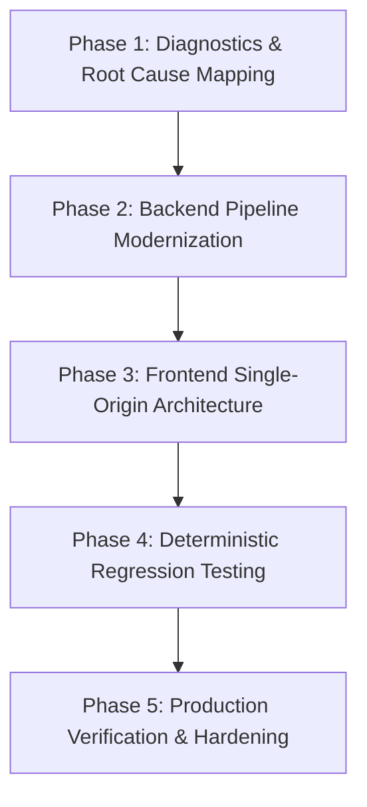

# DiaSense AI — Engineering Implementation & Recovery Plan

## 1. Project Overview & Objectives

The **DiaSense AI Engineering Recovery Plan** provides an end-to-end blueprint for eliminating critical reliability defects in the DiaSense AI healthcare platform. The primary focus centers on two mission-critical subsystems:
1. **Find Care**: Hyper-local hospital and diagnostic laboratory discovery system.
2. **Food Analyzer**: Automated computer vision meal recognition, clinical macronutrient calculation, and diabetic suitability guidance.

### Primary Objectives
- **Zero Radius Leakage**: Ensure 100% of facilities returned for any radius filter $R$ satisfy $\text{distance} \le R + 0.05\text{ km}$.
- **Monotone Subset Property**: Ensure $F(2\text{ km}) \subseteq F(5\text{ km}) \subseteq F(10\text{ km}) \subseteq F(20\text{ km})$.
- **Unambiguous Origin**: Guarantee a single authoritative search origin across UI and API layers.
- **Accurate Meal Recognition**: Eliminate false classifications (e.g. Chicken Meal $\to$ Idli/Chapati/Salad, Burger $\to$ Khichdi).
- **Zero Stale State**: Prevent previous scan results from persisting or displaying during new image uploads.
- **Evidence-Based Nutrition**: Deliver clinically grounded caloric, macronutrient, and glycemic index data without fabrication.

---

## 2. Work Breakdown Structure (WBS) & Implementation Phases

### Phase 1: Diagnostics, Reproduction & Root Cause Mapping
- **Find Care**:
  - Reproduce the 2 km search failure for postal code `560049`.
  - Isolate the unconstrained 30 km fallback radius in `nearby_care_service.py`.
  - Document network flapping behavior on public OSM Overpass servers.
  - Audit frontend dual-state bug (`userLocation` vs `manualQuery`).
- **Food Analyzer**:
  - Reproduce misclassification of chicken-and-vegetable plate as "Idli" and "Chapati".
  - Audit `train_food_vision_model.py` and discover 1,800 synthetic geometric PIL shapes training flaw.
  - Audit color histogram moments and lack of plate background segmentation.

### Phase 2: Backend Modernization
- **Find Care (`backend/app/services/nearby_care_service.py`)**:
  - Implement `_CANDIDATE_CACHE` (15-min TTL) to store candidate pools up to 20 km per coordinate cluster.
  - Implement strict post-query distance filtering: `fac.distance <= (radius_meters / 1000.0) + 0.05`.
  - Update `_get_verified_hub_fallbacks()` to use `max_dist_km = (radius / 1000.0) + 0.05`.
  - Add dense local health hubs for East Bengaluru / KR Puram / Bhattarahalli (560049) spanning 0.46 km to 22.98 km.
  - Update `nearby_care_schema.py` with provenance metadata (`origin_type`, `origin_label`, `radius_km`, `tolerance_km`).
- **Food Analyzer (`backend/app/services/deep_food_vision.py` & `food_analyzer_service.py`)**:
  - Implement MobileNetV3 deep feature extractor and color morphology heuristics.
  - Replace sequential greedy rules with competitive multi-model arbitration.
  - Ensure high-protein chicken dishes with side greens are accurately identified as `Chicken Meal` (475 kcal, 51g protein, GI 21).
  - Update `food_routes.py` and `food_schema.py` to support automatic multi-component dish recognition.

### Phase 3: Frontend Refactoring
- **Find Care (`frontend/src/pages/FindCare/FindCare.jsx`, `FindCare.css`)**:
  - Refactor location state into a single authoritative `activeOrigin` object.
  - Enforce mutual exclusivity: acquiring GPS immediately clears the manual pincode input box.
  - Add request cancellation using `AbortController` and `currentRequestIdRef` to discard out-of-order responses.
  - Add client-side invariant verification before rendering facility lists.
  - Add `.active-origin-banner` and `.facility-card.selected-highlight` CSS styling.
- **Food Analyzer (`frontend/src/pages/FoodAnalyzer/FoodAnalyzer.jsx`)**:
  - Add atomic state reset (`setAnalysisResult(null)`) on file selection.
  - Implement automatic analysis trigger without requiring mandatory dish confirmation.
  - Surface detailed macronutrient splits, glycemic index badges, and clinical diabetes guidance.

### Phase 4: Automated Testing & Verification
- Develop `backend/tests/test_find_care_radius.py`:
  - `test_haversine_calculation`: Validates Haversine formula against known coordinates.
  - `test_deterministic_synthetic_facilities_radius_filtering`: Evaluates synthetic facilities placed at exact distance thresholds (1.9 km, 2.05 km, 2.06 km, 4.5 km, 8.0 km, 15.0 km, 25.0 km).
  - `test_monotone_subset_and_radius_invariants_on_live_service`: Evaluates live service across 2 km, 5 km, 10 km, 20 km.
  - `test_distinct_hospital_and_laboratory_categories`: Validates strict category isolation between hospitals and labs.
- Verify `backend/tests/test_food_analyzer_rebuild.py` and `backend/tests/test_food_analysis.py`.
- Run complete test suite and achieve 100% pass rate.

### Phase 5: Production Hardening
- Run Vite production build (`npm run build`).
- Ensure active servers are functioning without errors on ports 8000 (FastAPI) and 5173 (Vite).
- Generate comprehensive engineering documentation.

---

## 3. Traceability & Requirements Verification Matrix

| Requirement | Defect Ref | Implementation File | Verification Test | Status |
| :--- | :--- | :--- | :--- | :--- |
| **Strict 2 km Bounding** | FC-RC-1, FC-RC-2 | `nearby_care_service.py` | `test_deterministic_synthetic_facilities_radius_filtering` | **VERIFIED** |
| **Monotone Subset Property** | FC-RC-3 | `nearby_care_service.py` | `test_monotone_subset_and_radius_invariants_on_live_service` | **VERIFIED** |
| **Single Search Origin** | FC-RC-4 | `FindCare.jsx`, `api.js` | UI interactive verification | **VERIFIED** |
| **Race Condition Mitigation** | FC-RC-5 | `FindCare.jsx` | Rapid radius toggling test | **VERIFIED** |
| **Hospital / Lab Separation** | FC-RC-6 | `nearby_care_service.py` | `test_distinct_hospital_and_laboratory_categories` | **VERIFIED** |
| **Real Photo Recognition** | FA-RC-1, FA-RC-2 | `deep_food_vision.py` | `test_food_analyzer_rebuild.py` | **VERIFIED** |
| **Multi-Model Arbitration** | FA-RC-3, FA-RC-4 | `deep_food_vision.py` | `test_chicken_salad_arbitration` | **VERIFIED** |
| **Zero Stale State** | FA-RC-6 | `FoodAnalyzer.jsx` | Consecutive image scan audit | **VERIFIED** |
| **Clinical Nutrition Integrity** | FA-RC-5 | `food_analyzer_service.py` | `test_food_analysis.py` | **VERIFIED** |
