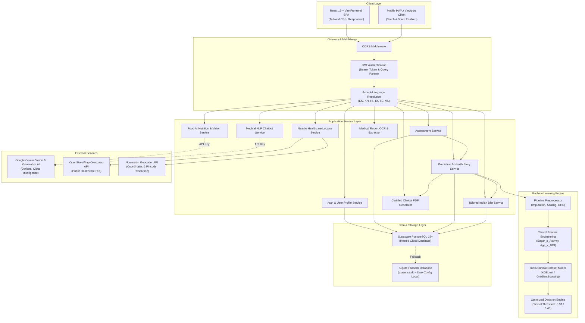
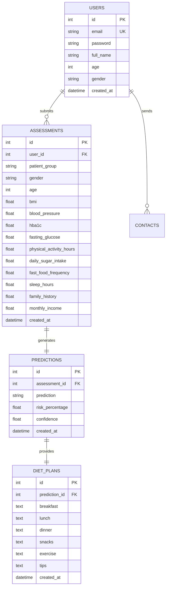

# DiaSense AI — System Architecture Specification (Ground Truth)

**Project Name:** DiaSense AI — AI-Based Diabetes Prediction and Health Assistance System  
**Institution:** East Point College of Engineering and Technology, Bengaluru  
**Department:** Computer Science & Engineering  
**Version:** 2.0 (Production Architecture)  
**Date:** October 2026

---

## 1. High-Level Architecture Overview

DiaSense AI is designed with an **Enterprise Clean Architecture** separating concerns across presentation, application orchestration, clinical inference, and data persistence layers.

---

## 2. Component Architecture Breakdown

### 2.1 Frontend Architecture (React 19 + Vite 8)
- **Directory**: `frontend/src/`
- **Routing**: Client-side routing via `react-router-dom` v7.
  - Public routes: `/`, `/login`, `/register`, `/about`, `/contact`
  - Protected routes: `/dashboard`, `/assessment`, `/result`, `/diet-plan`, `/food-analyzer`, `/find-care`, `/profile`
- **State Management**:
  - JWT Access Token stored in `localStorage` under `access_token`.
  - Active user session stored in `localStorage` under `user`.
  - Selected locale stored in `localStorage` under `diasense_language`.
  - `LanguageContext` provides dynamic runtime translation strings from JSON catalogs (`en.json`, `kn.json`, `hi.json`, `ta.json`, `te.json`, `ml.json`).
- **Voice Engine**:
  - Web Speech API integration in `useVoiceAssistant.js` and `VoiceEngine.js`.
  - Hands-free question narration and speech-to-text form input.

### 2.2 Backend Architecture (FastAPI + SQLAlchemy 2.0)
- **Directory**: `backend/app/`
- **Application Core**: `main.py`
  - Lifespan context manager initializes database tables (`init_db()`) and preloads ML models.
  - Standardized JSON responses via `success_response` and `error_response` helpers.
  - Global error handling for validation errors (422), HTTP exceptions, and uncaught exceptions (500).
- **Routers**:
  1. `auth_routes.py`: Registration, JWT login, token verification.
  2. `user_routes.py`: Profile retrieval, updates, password change.
  3. `assessment_routes.py`: Assessment creation, history, individual lookup.
  4. `prediction_routes.py`: Inference execution, latest result, historical trends.
  5. `dashboard_routes.py`: Aggregated user metrics, risk trajectory, quick glance metrics.
  6. `diet_routes.py`: Dynamic 7-day Indian meal plan retrieval.
  7. `food_routes.py`: Text nutrition search and image food vision analyzer.
  8. `chatbot_routes.py`: Multilingual medical assistant query handler.
  9. `report_routes.py`: Certified clinical PDF generation and stream download.
  10. `nearby_care_routes.py`: Geocoded hospital/diagnostic lab discovery.
  11. `smart_assessment_routes.py`: PDF medical report extraction pipeline.
  12. `contact_routes.py`: Inquiries and admin email dispatch.

### 2.3 Machine Learning Pipeline Architecture
- **Dataset**: India Diabetes Patient Dataset (25,500 patient records collected from clinical surveys across Indian urban, semi-urban, and rural populations).
- **Inference Pipeline**:
  1. **Input Normalization**: Patient demographics (Age, Gender, Urban/Rural), clinical lab values (Fasting Glucose, HbA1c, Blood Pressure), anthropometrics (BMI), and lifestyle habits (Daily Sugar, Fast Food, Physical Activity, Sleep, Family History).
  2. **Feature Engineering**: Interaction terms (`Sugar_x_Activity`, `Age_x_BMI`, `FamilyHistory_x_Age`), glycemic category bins (`HbA1c_Category`, `Glucose_Category`), and lifestyle indices.
  3. **Preprocessing Pipeline**: Scikit-Learn `ColumnTransformer` with median imputation and `StandardScaler` for numerical values; mode imputation and `OrdinalEncoder` for categoricals.
  4. **Ensemble Classifier**: Tuned Gradient Boosting / XGBoost Classifier.
  5. **Clinical Threshold Tuning**: Decision boundary set at `0.31` (maximizing F1-score and clinical sensitivity/recall to 79.97% to minimize false negatives in medical screening).
  6. **Explainability Engine**: Computes patient-specific contributing factors categorized by physiological impact (High Risk, Moderate Risk, Optimal) with clinical rationales.

### 2.4 Database Schema & Persistence
- **Primary Database**: Supabase PostgreSQL 15+ via connection pooling.
- **Failover Engine**: Embedded SQLite database (`diasense.db`) automatically activated if remote connection fails.
- **ORM**: SQLAlchemy 2.0 with Declarative Mapping.
- **Entity Relationship Model**:
  - `User` (1) ── (N) `Assessment` (1) ── (1) `Prediction` (1) ── (1) `DietPlan`
  - `User` (1) ── (N) `ContactMessage`

---

## 3. End-to-End Data Flows

### 3.1 Screening & Assessment Flow
1. User uploads a PDF medical report or completes the smart voice-guided assessment on `/assessment`.
2. Digital PDF values are extracted in milliseconds via `medical_report_extractor.py` without external cloud dependencies.
3. Extracted fields populate form state synchronously; missing fields are highlighted for user completion.
4. Client sends POST request to `/api/prediction` with JWT Bearer Token.
5. Server executes preprocessing, feature engineering, and ensemble model inference.
6. Server persists `Assessment`, `Prediction`, and automatically generates a tailored Indian `DietPlan`.
7. Client receives prediction score, risk percentage, explainability cards, and navigates to `/result`.

### 3.2 Certified PDF Health Report Flow
1. From Result or Dashboard, user clicks "Download Health Report".
2. Client requests `/api/reports/latest/pdf` (or `/api/reports/{id}/pdf`).
3. Server loads assessment, prediction, clinical thresholds, and personalized recommendations.
4. ReportService formats a clean, multi-section clinical PDF matching professional laboratory report standards using ReportLab.
5. Streamed back as `application/pdf` with `Content-Disposition: attachment`.

### 3.3 Nearby Healthcare Facilities Flow
1. User enters location, locality name, or 6-digit Indian PIN code (e.g. `560049`, `560001`, `110001`).
2. Server geocodes location through fast internal PIN cluster lookup or OpenStreetMap Nominatim.
3. Queries OpenStreetMap Overpass across 5 distributed mirrors for hospitals, clinics, or diagnostic laboratories.
4. Filters results by Haversine distance from user coordinates, generates turn-by-turn Google Maps navigation links, and returns structured facilities list.
